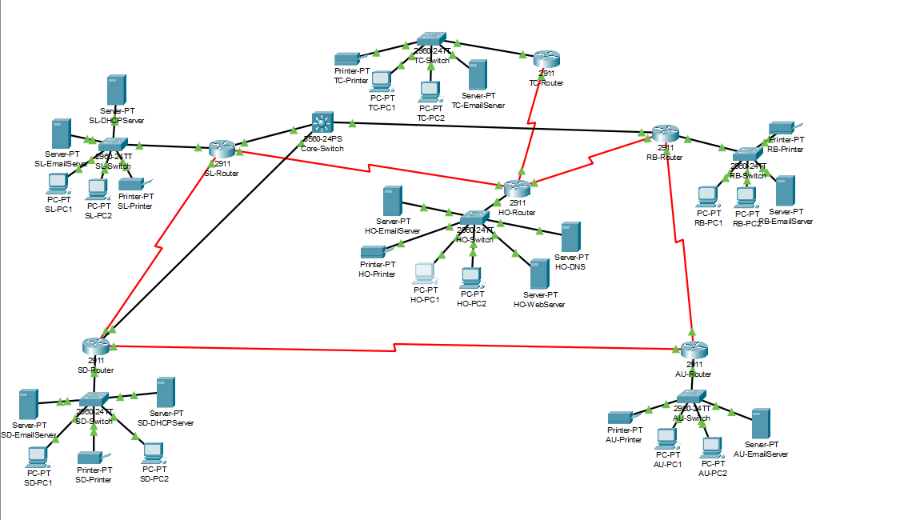

# Smart Integrated Service Network (SISN)

An enterprise network of six organizational units designed and simulated in **Cisco Packet Tracer**, built for **CSE421 (Computer Networks)** at BRAC University. It combines VLSM addressing, static and dynamic routing (RIPv2), DHCP, DNS, web and email services, and fault-tolerance testing.





## Highlights

- **VLSM addressing** from the base network `9.9.0.0/16`, with /30 subnets for the point-to-point router links.
- **Routing:** RIPv2 across all routers, plus next-hop, recursive, exit-interface, default and floating static routes (AD 121 as backup to RIP).
- **DHCP:** router-based pools (TC, RB) and dedicated DHCP servers (SL, SD); HO and AU use static addressing.
- **Services:** DNS (`www.sisn.local`), HTTP web server, and SMTP/POP3 email on `sisn.com`.
- **Fault tolerance:** link-failure rerouting, floating static backup route, and recursive static route tests.

## Address plan

| Unit | Network | Mask | Usable hosts |
|------|---------|------|--------------|
| HO (Head Office) | 9.9.0.0/23 | 255.255.254.0 | 510 |
| TC | 9.9.2.0/24 | 255.255.255.0 | 254 |
| SL | 9.9.3.0/25 | 255.255.255.128 | 126 |
| SD | 9.9.3.128/25 | 255.255.255.128 | 126 |
| RB | 9.9.4.0/25 | 255.255.255.128 | 126 |
| AU | 9.9.4.128/26 | 255.255.255.192 | 62 |

Inter-router links use /30 subnets in `9.9.4.192/30` to `9.9.4.216/30`.

## Network design

| Link | Subnet |
|------|--------|
| HO – TC | 9.9.4.192/30 |
| HO – SL | 9.9.4.196/30 |
| HO – RB | 9.9.4.200/30 |
| SL – SD | 9.9.4.204/30 |
| SD – AU | 9.9.4.212/30 |
| RB – AU | 9.9.4.216/30 |

Key servers (all in HO): DNS `9.9.0.6`, web `9.9.0.7`, email `9.9.0.5`.

## How to open the project

1. Install **Cisco Packet Tracer** (free from Cisco Networking Academy).
2. Open `sisn-network.pkt` in Packet Tracer.
3. The full router CLI configurations, addressing tables, test procedures and screenshots are in `report.pdf`.

## Repository structure

```
.
├── README.md
├── report.pdf          # Full documentation: VLSM tree, CLI configs, tables, verification, tests
└── sisn-network.pkt    # Cisco Packet Tracer simulation file
```
